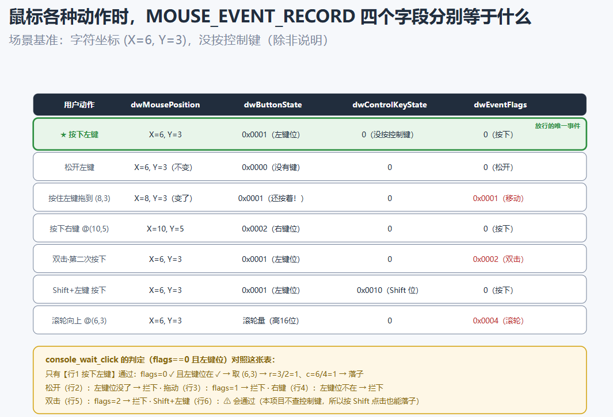
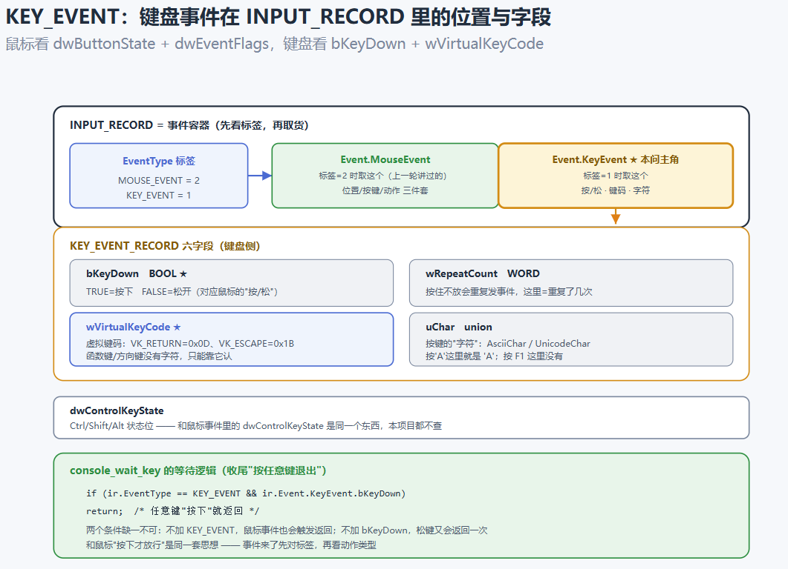

## md 的框架编排用了 AI 协助；代码部分，因为这道题涉及到的东西我感觉有点无从下手，所以借助 AI 的程度相较于前几题更多。AI主要帮我做了纠错、查 API 用法和解释概念，还有一些代码是我先描述自己的思路，把我遇到困难的点让 AI 教我，我再对着去逐一学习理解的。

## 这一章和前几章不太一样：不是回答概念题，而是从头到尾做一个完整的小东西，而且是第一次写多文件工程，前前后后有一堆函数和结构体，绕的人很昏。还有API的一堆相关变量 函数，反正就是一堆东西，要就着旁边的记录来回比对。

## 因为刚开始很陌生，所以我在“在初始化控制台，打开鼠标输入”这一板块写了大量关于API的注释，辅助自己理解。

## 然后debug相关的流程我确实不太会，是让 AI带着我边分析边做的。 

------

# C-EASY-4：小应用之五子棋游戏

## Step 1：项目要求与项目结构

### 1. 先搞清楚到底要做啥子东西

把题目要求用自己的话过一遍：

1. 终端里显示一个 9×9 的棋盘，用 ASCII 字符（就是 `+`、`-`、`|` 这些普通字符）拼出来；
2. 两个人轮流下，X 先手，O 后手；
3. 不用键盘输入坐标，而是**用鼠标左键点格子**落子；
4. 已经有棋子的格子不能再下；
5. 横、竖、斜（两条斜线）任何一个方向连续凑够 5 个同色棋子就赢；
6. 81 个格子全下满还没人赢，就算平局。

这其实就是一个"把棋盘状态存起来 → 把状态画出来 → 接收点击改状态 → 判断结束没有"的循环。

### 2. 为什么要拆成多个文件？

前几章我都是一两个 `.c` 文件从头写到尾，小程序当然没问题。但项目稍微一大，单文件就有麻烦：

- 找一个函数要在几百行里翻；
- 显示的代码和游戏规则的代码混在一起，改显示怕动坏规则；
- 没法分工，也没法把写好的部分拿去复用。

题目建议的拆法，是按功能来分：

| 文件 | 管什么 |
|---|---|
| `game.h` | 棋盘相关的常量、枚举、结构体、函数声明（说明书） |
| `game.c` | 游戏规则：落子、判胜负、判平局（只操作数据） |
| `console.h` | 控制台相关的结构体、函数声明 |
| `console.c` | 读鼠标、坐标换算、画棋盘、刷新画面（执行落子） |
| `main.c` | 初始化、主循环、指挥上面game、console两个模块 |

核心思想是：**`game.c` 只管"数据和规则"；`console.c` 只管"输入和显示"，二者互不干扰。** 两边通过 `main.c` 串起来。这样以后想把棋盘改成 15×15、或者想换成键盘输入，要动的部分都很清楚。

### 3. 多文件到底是怎么变成一个程序的？

这是我这章新搞明白的东西。之前以为"编译"就是一步，其实一个 C 程序从源码到 exe 大致经过：

1. **预处理**：处理 `#include`、`#define` 这些。`#include` 做的事很朴素——把那个头文件的内容**原封不动复制**到当前位置；宏则做文本替换。
2. **编译（含汇编）**：每个 `.c` 文件各自独立地被翻译成一个**目标文件**（`.o` / `.obj`）。注意是**每个 `.c` 各编译各的**，互相不知道对方长什么样。
3. **链接**：把所有目标文件、再加上系统库拼在一起，把"这个函数调用到底跳到哪"的地址补上，最后得到一个 exe。

这就解释了头文件的角色：`game.c` 里要用的 `Game` 结构体，`main.c` 里也得知道它长什么样，否则 `main.c` 单独编译时根本算不出 `Game` 占多少字节。把这些**共用的定义和函数声明**放进 `.h`，谁要用谁就 `#include` 进来。

两条注意事项：

- **声明可以出现很多次（放 .h），定义只能出现一次（放 .c）**。如果把函数体写进头文件又被两个 `.c` 包含，链接时就会报"重复定义"。
- **头文件要加保护**，防止被绕一圈重复包含：

```c
#ifndef GAME_H  /* 如果宏 GAME_H 还没被定义过, */
#define GAME_H  /* 那么就定义它，相当于做个"来过了"的记号 */

/* 中间放真正的内容 */

#endif /* 条件编译块到此结束 */
```

意思是"如果没定义过 GAME_H，就定义它并把内容包含进来；已经定义过，整段跳过"。

### 4. 先把数据想清楚：宏、枚举、结构体

写逻辑之前，先想"一盘游戏需要记住哪些信息"。

#### 三个宏

```c
#define BOARD_SIZE 9     /* 棋盘边长 */
#define WIN_LENGTH 5     /* 连几个子算赢 */
#define EMPTY_CELL '.'   /* 空格子在棋盘上显示什么 */
```

为什么不直接在代码里写 9、5、'.'？因为这种数字会在很多地方出现，起了名字之后，一是看代码就知道这个 9 是什么意思，二是想改成 13×13 棋盘时，只改宏这一处，不用满世界找 9。

#### 两个枚举

枚举（`enum`）就是给一组整数取名字。否则用 `0、1、2、3` 表示状态，过两天自己都忘了 2 是什么。

```c
typedef enum {
    GAME_RUNNING,   /* 0，游戏进行中 */
    GAME_X_WINS,    /* 1，X 获胜 */
    GAME_O_WINS,    /* 2，O 获胜 */
    GAME_DRAW       /* 3，平局 */
} GameStatus;
```

枚举成员默认从 **0** 开始，往后依次加 1，也可以手动指定。

```c
typedef enum {
    MOVE_ACCEPTED,       /* 0，落子成功 */
    MOVE_OUT_OF_BOUNDS,  /* 1，点到棋盘外面了 */
    MOVE_OCCUPIED        /* 2，这个格子已经有棋子 */
} MoveResult;
```

为什么要专门定义"落子结果"？因为点错位置时，程序要能区分是"点外面了"还是"格子有人了"，好给不同的提示，而且这两种情况下都不能换手、不能加步数。

#### Game 结构体

```c
typedef struct {
    char cells[BOARD_SIZE][BOARD_SIZE]; /* 棋盘：cells[行][列] */
    char current_player;                /* 现在轮到谁 */
    int move_count;                     /* 已经落了多少子 */
    GameStatus status;                  /* 游戏状态 */
} Game;
```

- `cells` 是个 9×9 的 char 二维数组，因为棋子和空位正好用 `'X'`、`'O'`、`'.'` 三个字符就能表示。
- `move_count` 除了报步数，还要靠它判断平局（满 81）。
- `status` 让主循环知道"还要不要继续"。

#### 完整的 game.h

```c
#ifndef GAME_H
#define GAME_H

/* 棋盘边长：9 行 9 列 */
#define BOARD_SIZE 9

/* 连续多少个子算赢 */
#define WIN_LENGTH 5

/* 空格子的标记 */
#define EMPTY_CELL '.'

/* 游戏当前处于什么状态 */
typedef enum {
    GAME_RUNNING,   /* 还在下 */
    GAME_X_WINS,    /* X 赢了 */
    GAME_O_WINS,    /* O 赢了 */
    GAME_DRAW       /* 平局 */
} GameStatus;

/* 一次落子的结果 */
typedef enum {
    MOVE_ACCEPTED,       /* 落子成功 */
    MOVE_OUT_OF_BOUNDS,  /* 点到棋盘外面了 */
    MOVE_OCCUPIED        /* 这个格子已经有棋子 */
} MoveResult;

/* 一盘游戏的全部数据 */
typedef struct {
    char cells[BOARD_SIZE][BOARD_SIZE]; /* 棋盘，cells[行][列] */
    char current_player;                /* 现在轮到谁落子 */
    int move_count;                     /* 已经落了多少个子 */
    GameStatus status;                  /* 游戏状态 */
} Game;

/* 把一盘新游戏初始化好 */
void game_init(Game *game);

/* 在 (row, col) 落子，并更新游戏数据和状态，返回这次落子的结果 */
MoveResult game_place(Game *game, int row, int col);

#endif
```

头文件里只声明了两个对外函数。判胜负的 `check_win` 我打算只在 `game.c` 内部用，所以不写在这里（后面讲）。

### 5. 先搭主循环的骨架

先用伪代码写出来：

```c
int main(void)
{
    初始化 Game;
    初始化控制台;
    画一次棋盘;

    while (游戏还在进行中) {
        画/更新棋盘;
        等玩家点一个棋盘内的格子;
        落子（内部会判胜负、平局、换人）;
        刷新状态信息;
    }

    显示最终结果;
    等玩家按个键;
    把控制台恢复成原样;
    return 0;
}
```

骨架对了，后面就是一个函数一个函数填。

---

## Step 2：引入坐标，绘制棋盘

### 1. 鼠标是怎么读到的？——Windows Console API

`scanf` 只能读键盘，鼠标点了一下，C 语言本身（语法层面）没有管这个的东西。因为"终端窗口"是操作系统提供的，得找**操作系统**要。

在 Windows 上，系统提供了一组专门控制控制台窗口的函数，叫 **Windows Console API**，可以读键盘、读鼠标、移动光标、改颜色、操作屏幕缓冲区。题目也说了这章不用学很深，**会读鼠标左键按下时的位置**就够。

用这些 API 要包含头文件：

```c
#include <windows.h>
```

先认识一个概念：**句柄（HANDLE）**。可以理解成操作系统发给你的一张"凭证"，你想操作终端，先得拿着凭证。取得输入、输出凭证的函数：

```c
HANDLE hInput  = GetStdHandle(STD_INPUT_HANDLE);   /* 标准输入（键盘/鼠标） */
HANDLE hOutput = GetStdHandle(STD_OUTPUT_HANDLE);  /* 标准输出（屏幕） */
```

### 2. 棋盘的格子到底占多大

题目给的棋盘样式：

```
+---+---+---+---+---+---+---+---+---+
| . | . | . | . | . | . | . | . | . |
+---+---+---+---+---+---+---+---+---+
| . | . | . | . | . | . | . | . | . |
+---+---+---+---+---+---+---+---+---+
```

- **宽度（横向）**：一个格子占 4 个字符：`|` 或 `+` 算左边线，然后三个字符 `---` / ` . `。
- **高度（纵向）**：一个格子占 2 行：一行边线、一行棋子。
- 棋子（`.` 或 `X`、`O`）正好坐在格子正中央。

所以整块棋盘：宽 9×4+1 = **37** 个字符，高 9×2+1 = **19** 行。

### 3. 两套坐标（这章的关键概念）

这里要同时处理两套坐标：

| | 棋盘坐标 | 字符坐标（屏幕坐标） |
|---|---|---|
| 表示 | `(row, col)`，取值 0~8 | `(X, Y)`，屏幕上第几列、第几行字符 |
| 谁用 | 游戏数据、规则（`cells` 数组） | 画棋盘、读鼠标位置 |

**正向公式（棋盘坐标 → 棋子在屏幕上的字符位置）：**

- 棋子的横向位置：`X = 4 * col + 2`
- 棋子的纵向位置：`Y = 2 * row + 1`

列几个验证：

| 棋盘格子 | 棋子字符坐标 |
|---|---|
| 第 0 行第 0 列 | (2, 1) |
| 第 0 行第 1 列 | (6, 1) |
| 第 1 行第 0 列 | (2, 3) |
| 第 4 行第 4 列 | (18, 9) |

和上面的样式对得上：第 0 个棋子在 `| .` 中 `.` 的位置，即 X=2；边线占第 0 行，棋子在第 1 行，即 Y=1。

**为什么非要设计两套坐标？** 我是这样理解的：

- 游戏逻辑只关心"第几行第几列是什么棋子"，它不应该知道格子画成 4 宽还是 3 宽。
- 显示和鼠标必须知道精确的字符位置，否则没法画棋子、没法判断点了哪个格。
- 两套坐标用公式隔开之后，**想改棋盘样式只动显示层，规则代码一行不用改**。这也是前面"分模块"的好处。

### 4. 把棋盘画出来

思路：一共 9 行格子，每一行先画上边线，再画棋子行；全部画完后补一条最底下的边线。

```c
void console_draw_board(const Game *game) // const ,只读
{
    int row, col;

    for (row = 0; row < BOARD_SIZE; row++)
    {
        /* 格子上边线：+---+---+...+ */
        for (col = 0; col < BOARD_SIZE; col++)
        {
            printf("+---");
        }
        printf("+\n");

        /* 棋子行：| X | . |...| */
        for (col = 0; col < BOARD_SIZE; col++)
        {
            printf("| %c ", game->cells[row][col]);
        }
        printf("|\n");
    }

    /* 棋盘最底下的边线 */
    for (col = 0; col < BOARD_SIZE; col++)
    {
        printf("+---");
    }
    printf("+\n");
}
```

说明两点：

- 边线行打印 9 个 `+---` 后再补一个 `+` 收尾，正好把右边封上。
- 参数里的 `const Game *game`：`const` 表示"我在这里**只读这个 Game、不会改它**"，是个自我约束，也让看代码的人放心。

我本地跑了一下，打印结果是这样的：

```
+---+---+---+---+---+---+---+---+---+
| . | . | . | . | . | . | . | . | . |
+---+---+---+---+---+---+---+---+---+
| . | . | . | . | . | . | . | . | . |
+---+---+---+---+---+---+---+---+---+
            （中间六行略）
+---+---+---+---+---+---+---+---+---+
| . | . | . | . | . | . | . | . | . |
+---+---+---+---+---+---+---+---+---+
```

### 5. 初始化控制台，打开鼠标输入

先定义控制台结构体（放在 `console.h`）就是把句柄和"原始设置"收在一起，方便退出时恢复：

```c
typedef struct {
    HANDLE hInput;
    HANDLE hOutput;
    DWORD original_input_mode; // 无符号 32 位整数,每个位是一个开关
    CONSOLE_CURSOR_INFO original_cursor;
} GameConsole;
```

在读鼠标之前，得先告诉系统"我要接收鼠标事件"。

```c
void console_init(GameConsole *con) 
{
    // 1 拿句柄
    con->hInput = GetStdHandle(STD_INPUT_HANDLE); 
    con->hOutput = GetStdHandle(STD_OUTPUT_HANDLE); 
	
    // 2 存档底片
    /* 先把原来的设置(当前模式)读出来并存进结构体，留着退出时还原 */
    // 小巧思："读当前值" 而不是 "写死一个默认值" 来还原，更尊重原来的环境，退出时按原样还回去。
    // 读取信息时用"&"，传地址
    // 参数1：查哪个设备（输入 or 输出）; 参数2：结果写到这个地址（输出参数）
    GetConsoleMode(con->hInput, &con->original_input_mode);    // 读标准输入的当前模式
    GetConsoleCursorInfo(con->hOutput, &con->original_cursor); // 读标准输出的当前光标信息

    // 3 开鼠标模式 ★
    /*
     * 打开鼠标输入。
     * 故意不写 ENABLE_QUICK_EDIT_MODE（快速编辑模式）：
     * 开着它时，鼠标左键在终端里是"拖选文字"，程序根本收不到点击。
     * ENABLE_EXTENDED_FLAGS 是修改 QuickEdit 开关时必须搭配的标志(钥匙)。
     * 另外，"不写 = 关"，整组覆盖时，原来开着的位没写进 mode，就全被关掉。
     */
    // DWORD这行:把各开关拼成一个新模式。用"|"按位或，把三个标志的二进制位合进一个整数。
/*这三项分别是"改 QuickEdit 的钥匙"、窗口被拖大/拖小时系统发事件提醒(顺带)、鼠标事件(最重要)*/
    DWORD mode = ENABLE_EXTENDED_FLAGS | ENABLE_WINDOW_INPUT | ENABLE_MOUSE_INPUT;
    SetConsoleMode(con->hInput, mode);

    // 4 藏光标 + 清屏
    /* 隐藏闪烁的光标，好看一点 */
    CONSOLE_CURSOR_INFO cursor = con->original_cursor; // 复制一份光标设置到局部变量cursor(在副本上改，底片保持原样)
    cursor.bVisible = FALSE; // 把副本的 "是否可见" 改成不可见（FALSE 就是 0）
    SetConsoleCursorInfo(con->hOutput, &cursor); // 用改好的副本更新控制台的输出

    system("cls"); // system = int system(const char *command); cls意思是Clear Screen。
}
```

**然后你就会发现按上面的代码写好之后运行不起。。。。。。。。。。。。。。。。**

因为如果开鼠标模式，再清屏，system ("cls") 会启动 cmd.exe 子进程，它会重置共享控制台的输入模式，把刚打开的 ENABLE_MOUSE_INPUT 关掉，导致后续 ReadConsoleInput 收不到鼠标事件。

所以要把 system("cls") 挪到 SetConsoleMode 之前。

或者不用 system()，改用 Windows API 清屏（FillConsoleOutputCharacter）。（下面这一坨我暂时还没细看，因为又引入了好几个新 API）

```c
static void clear_screen(GameConsole *con)
{
    CONSOLE_SCREEN_BUFFER_INFO info;
    DWORD total_cells, written;
    COORD home;

    home.X = 0;
    home.Y = 0;

    GetConsoleScreenBufferInfo(con->hOutput, &info);
    total_cells = info.dwSize.X * info.dwSize.Y;

    FillConsoleOutputCharacter(con->hOutput, ' ', total_cells, home, &written);
    FillConsoleOutputAttribute(con->hOutput, info.wAttributes, total_cells, home, &written);
    SetConsoleCursorPosition(con->hOutput, home);
}
```

**关于QuickEdit **：最开始没关，程序运行后我点棋盘，结果是在终端里拖出一个"选中文字"的白框，程序没有反应，查了才知道，快速编辑模式下鼠标事件被系统拿去做文本选择了，不发给程序。

**关于"&"的使用**：

`Get` 两个函数都用 `&`，是因为它们要把数据**从函数里带出来**——"输出参数"。C 语言里函数只能返回一个值，而 Windows API 的返回值还要留着报 "成功 / 失败"（BOOL），所以多出来的数据只能靠传地址带出来。

`Set`两个函数：只有 "单个整数 + 只送进去" 才直接传值，而结构体必须用 `&`。

### 6. 读取鼠标事件

Console API 里，鼠标和键盘的动作都叫"**事件**"。用 `ReadConsoleInput` 取一个事件，它填进一个 `INPUT_RECORD`（输入记录）里：

```c
INPUT_RECORD ir;
DWORD num_read;
ReadConsoleInput(con->hInput, &ir, 1, &num_read);
```

`INPUT_RECORD` 里先看 `EventType`（事件类型）：

- 鼠标事件是 `MOUSE_EVENT`；
- 键盘事件是 `KEY_EVENT`；
- （其实还有窗口大小变化等等其他事件）

鼠标事件的细节在 `ir.Event.MouseEvent` 里，主要用三个字段：

| 字段 | 含义 |
|---|---|
| `dwButtonState` | 哪个键正按着（位标记，用 `&` 检查某一位） |
| `dwEventFlags` | 什么动作：移动、双击、滚轮，还是普通的按下/松开 |
| `dwMousePosition` | 鼠标当时在屏幕缓冲区的字符坐标，`.X` 是列、`.Y` 是行 |

左键这一位叫 `FROM_LEFT_1ST_BUTTON_PRESSED`。

还有个**重复落子的坑**：点一下其实会来两次事件——按下一次、松开一次，两次的 `dwEventFlags` 都是 0。区分它们靠 `dwButtonState`：按下时含左键位，松开时不含。所以判断条件必须同时写"`dwEventFlags == 0` 且左键处于按下状态"，否则一颗子会在按下、松开时各落一次。

**注：**

1 `INPUT_RECORD`：

```c
typedef struct _INPUT_RECORD {
    WORD EventType;          // 成员①：事件类型标签（2 字节）
    union {                   // 成员②：联合体
        KEY_EVENT_RECORD             KeyEvent;
        MOUSE_EVENT_RECORD           MouseEvent;
        WINDOW_BUFFER_SIZE_RECORD    WindowBufferSizeEvent;
        MENU_EVENT_RECORD            MenuEvent;
        FOCUS_EVENT_RECORD           FocusEvent;
    } Event;                  // 成员②这个 union 的名字叫 Event
} INPUT_RECORD;
```

2 `ReadConsoleInput`:

```c
BOOL ReadConsoleInput(
    HANDLE  hConsoleInput,        // ① 从哪个设备读
    PINPUT_RECORD lpBuffer,       // ② 结果写到哪（输出参数）
    DWORD   nLength,              // ③ 申请几条（输入）
    LPDWORD lpNumberOfEventsRead  // ④ 实际几条（输出参数）
);
```

3 **鼠标各种动作时，MOUSE_EVENT_RECORD 四个字段分别等于什么**


完整的等待点击函数：

```c
int console_wait_click(GameConsole *con, int *row, int *col)
{
    INPUT_RECORD ir; // 声明: 向系统要了一块名字叫 ir 的、能装下 INPUT_RECORD 的内存
    DWORD num_read;  // 声明：这次调用实际读到的事件条数

    while (1) // 阻塞等待：队列里没事件时，程序停在这一行，等事件来了才返回。
    {
        ReadConsoleInput(con->hInput, &ir, 1, &num_read);

        if (ir.EventType == MOUSE_EVENT) // 按下鼠标
        {
            MOUSE_EVENT_RECORD *mouse = &ir.Event.MouseEvent;

            if (mouse->dwEventFlags == 0 &&
                (mouse->dwButtonState & FROM_LEFT_1ST_BUTTON_PRESSED)) 
                // 普通点击(按下或松开) 且 按着的是左键 可以确定是 左键被按下
            {
                int x = mouse->dwMousePosition.X;
                int y = mouse->dwMousePosition.Y;

                /* 字符坐标转棋盘坐标，公式见下一小节 */
                int r = y / 2;
                int c = x / 4;

                if (r < 0 || r >= BOARD_SIZE || c < 0 || c >= BOARD_SIZE)
                {
                    return 0;   /* 此时点在棋盘外面 */
                }

                *row = r;
                *col = c;
                return 1;
            }
        }
    }
}
```

注意一个容易搞反的地方：`cells[row][col]` 第一维是**行**，而 `COORD` 里 `.X` 是**列**、`.Y` 是**行**。所以代码里是 `r = y / 2`、`c = x / 4`，易写反。

### 7. 反向公式：字符坐标 → 棋盘坐标（重点）

每个格子宽 4、高 2，那么把鼠标的字符坐标做**整数除法**，就得到格子编号：

```c
col = X / 4;
row = Y / 2;
```

**题目专门提示了"点在格子边界上怎么办"**，我对着表想了一下：

- 竖线（X 是 4 的倍数，比如 X=4）：`X/4` 算成右边那个格子（col=1）；
- 横线（Y 是 2 的倍数，比如 Y=2）：`Y/2` 算成下面那个格子（row=1）。

也就是说，**边界被整数除法自动"分配"给了右边和下边的格子**，不用我额外写判断。这样点格子里任何位置（包括边线）都能落子，不用要求玩家点得特别准。

但最外圈的边界要小心：

- 最右边的边线 X=36，`36/4 = 9` → col=9，超出 0~8；
- 最底下的边线 Y=18，`18/2 = 9` → row=9，超出 0~8。

这两种正好被 `>= BOARD_SIZE` 判成"点在棋盘外"，返回 0，主循环里继续等下一次点击。我觉得这个处理是合理的——最外圈的外边界本来就不属于任何格子。

> 另一种可选做法：如果你觉得"点在边界线上不算数"，可以加一个判断，`X % 4 == 0 || Y % 2 == 0` 时当成无效点击。我最后没采用，因为那样点边线上会"没反应"，体验不如直接归给相邻格子。

另外如果窗口太小导致内容滚上去了，坐标就会错位，所以运行时别把窗口缩太小。

### 8. 退出前恢复控制台

```c
void console_restore(GameConsole *con)
{
    SetConsoleMode(con->hInput, con->original_input_mode);
    SetConsoleCursorInfo(con->hOutput, &con->original_cursor);
}
```

程序自己改了鼠标模式、藏了光标，退出时要恢复，不能把人家的终端改得面目全非。

---

## Step 3：游戏结束的条件判定

### 1. 应该在哪一步检测？

我的第一反应是：每次落子后把整个棋盘 81 个格子扫一遍看有没有五连。仔细一想，其实完全没必要：

- 落子**之前**，棋盘上没有五连——否则游戏上一轮就已经结束了；
- 落子之后如果出现了五连，那这五连**一定包含刚刚落下的这颗子**，老棋子的排列没有任何变化。

所以**只需要在每次落子之后，以刚落下的这颗子为“中心”去检查**。这回答了题目"在哪一步检测"：落子之后立刻检测。而且要**在切换玩家之前**做，因为此时要判断的是"刚刚落子的人"赢没赢。

### 2. 怎么数这颗子连了几个

五子棋有 4 个可能连成线的方向：横、竖、主斜线 `\`、副斜线 `/`。

以横向为例：

1. 计数 `count` 从 1 开始，先把刚落下的自己算上；
2. 往**右边**看：相邻格如果是同色，count 加 1，继续往右；一旦碰到异色、空格或棋盘边，就停；
3. 往**左边**看：同样数一遍；
4. 最后 count ≥ 5，就是五连。

数的时候每走一步都要检查坐标还在 0~8 内，不然就数到数组外面去了。

### 3. 用方向数组把四个方向收敛

如果老老实实为四个方向各写一遍，会是四段几乎一样的代码。我学到一个办法——**方向数组**：

```c
int dirs[4][2] = {
    {0, 1},   /* 横向：行不变，列 +1 */
    {1, 0},   /* 纵向：行 +1，列不变 */
    {1, 1},   /* 主斜线 \：行、列都 +1 */
    {1, -1}   /* 副斜线 /：行 +1，列 -1 */
};
```

把它理解成一张"步表"：每一行写的是"沿这个方向迈一步，行变化多少、列变化多少"。然后外层循环遍历 4 个方向，内层统一用"正方向数一遍、反方向数一遍"：

```c
/*
 * 检查刚在 (row, col) 落下的这颗子有没有形成五连。
 * 形成了返回 1，没有返回 0。
 * static 表示这个函数只在 game.c 内部使用，不对外提供。（"内部工具函数" 的标准写法）
 */
static int check_win(const Game *game, int row, int col)
{
    char player = game->cells[row][col];

    int dirs[4][2] = {
        {0, 1}, // 右
        {1, 0}, // 下
        {1, 1}, // 右下
        {1, -1} // 左下
    };

    for (int d = 0; d < 4; d++)
    {
        int dr = dirs[d][0];
        int dc = dirs[d][1];
        int count = 1;   /* 先把刚落下的这颗子算上 */
        int r, c;

        /* 沿着 (dr, dc) 方向数同色棋子 */
        r = row + dr;
        c = col + dc;
        while (r >= 0 && r < BOARD_SIZE && c >= 0 && c < BOARD_SIZE
               && game->cells[r][c] == player)
        {
            count++;
            r = r + dr;
            c = c + dc;
        }

        /* 沿着反方向数 */
        r = row - dr;
        c = col - dc;
        while (r >= 0 && r < BOARD_SIZE && c >= 0 && c < BOARD_SIZE
               && game->cells[r][c] == player)
        {
            count++;
            r = r - dr;
            c = c - dc;
        }

        if (count >= WIN_LENGTH)
        {
            return 1;
        }
    }

    return 0;
}
```

这里 `static` 是新东西：加在函数前，表示"这个函数只在本文件内部使用"，属于内部实现，不对外暴露。这样头文件里也不用声明它。

为什么要正反两个方向都数？因为第五颗子不一定接在队伍末端，也可能补在中间。比如 `XX.XX` 时在中间空位补一颗，左边 2 颗、右边 2 颗、加上自己正好 5 颗。只数一个方向会漏掉这种情况。

### 4. 平局怎么判

`move_count` 等于 81（也就是 `BOARD_SIZE * BOARD_SIZE`）说明棋盘下满了，这时又没有五连，就是平局。注意顺序：**先判胜负，再判平局**——理论上最后一步有可能既是第 81 子、又正好五连，这时应该算赢。

### 5. game_place：把落子的完整流程串起来

落子函数要按顺序处理：越界 → 占用 → 写棋子 → 判胜负 → 判平局 → 换人。

```c
MoveResult game_place(Game *game, int row, int col)
{
    /* 逻辑层自己再检查一次边界，不完全信任外面传来的坐标 */
    if (row < 0 || row >= BOARD_SIZE || col < 0 || col >= BOARD_SIZE)
    {
        return MOVE_OUT_OF_BOUNDS;
    }

    if (game->cells[row][col] != EMPTY_CELL)
    {
        return MOVE_OCCUPIED;
    }

    /* 落子 */
    game->cells[row][col] = game->current_player;
    game->move_count++;

    /*
     * 胜负判定在切换玩家之前做：
     * 现在要判断的是"刚刚落子的这个人"赢没赢。
     */
    if (check_win(game, row, col))
    {
        if (game->current_player == 'X')
        {
            game->status = GAME_X_WINS;
        }
        else
        {
            game->status = GAME_O_WINS;
        }
    }
    else if (game->move_count == BOARD_SIZE * BOARD_SIZE)
    {
        /* 81 个格子全满又没人赢，平局 */
        game->status = GAME_DRAW;
    }
    else
    {
        /* 既没赢也没平局，换人 */
        if (game->current_player == 'X')
        {
            game->current_player = 'O';
        }
        else
        {
            game->current_player = 'X';
        }
    }

    return MOVE_ACCEPTED;
}
```

两个细节：

- 越界和占用时是**直接 return** 的，所以步数不会增加、玩家不会切换——即"点错不影响局面"。
- 即使 `console_wait_click` 已经挡过一次棋盘外点击，这里仍然保留越界检查。因为**显示层负责体验，逻辑层要自我保护**：万一以后别的地方调用 `game_place`，数据也不能被写坏。（ai告诉我这是好习惯 要尽早养成）

初始化一盘新游戏的函数：

```c
void game_init(Game *game)
{
    int r, c;

    for (r = 0; r < BOARD_SIZE; r++)
    {
        for (c = 0; c < BOARD_SIZE; c++)
        {
            game->cells[r][c] = EMPTY_CELL;
        }
    }

    game->current_player = 'X';   /* X 先手 */
    game->move_count = 0;
    game->status = GAME_RUNNING;
}
```

### 6. 完成主循环

把前面的东西都交给 `main.c` 串起来：

```c
#include "game.h"
#include "console.h"

int main(void)
{
    Game game;
    GameConsole con;

    game_init(&game);   // 棋盘清空 · status=进行中
    console_init(&con); // 开鼠标 · 存底片 · 清屏

    /* 先把空棋盘和状态行画出来 */
    console_draw_board(&game);
    console_draw_status(&con, &game, NULL);

    while (game.status == GAME_RUNNING)
    {
        int row, col;
        MoveResult result;

        /* 点在棋盘外面就继续等，并给出提示 */
        while (console_wait_click(&con, &row, &col) == 0)
        {
            console_draw_status(&con, &game, "点在棋盘外面了，请点棋盘的格子");
        }

        result = game_place(&game, row, col);

        if (result == MOVE_OCCUPIED)
        {
            /* 格子有棋子：什么都没变，提示一下，回合还是当前玩家 */
            console_draw_status(&con, &game, "这个格子已经有棋子了");
            continue;
        }

        if (result == MOVE_ACCEPTED)
        {
            /* 只更新刚落下的这颗子，再刷新状态行 */
            console_update_cell(&con, &game, row, col);
            console_draw_status(&con, &game, NULL);
        }
    }

    /* 游戏结束：状态行已经是最终结果，等按键后恢复控制台再退出 */
    console_draw_status(&con, &game, "按任意键退出");
    console_wait_key(&con);
    console_restore(&con);

    return 0;
}
```

游戏结束时暂停画面用的等按键函数（只认键盘按下）：

```c
void console_wait_key(GameConsole *con)
{
    INPUT_RECORD ir;
    DWORD num_read;

    while (1)
    {
        ReadConsoleInput(con->hInput, &ir, 1, &num_read);

        if (ir.EventType == KEY_EVENT && ir.Event.KeyEvent.bKeyDown)
        {
            return;
        }
    }
}
```



### 7. 状态信息放在棋盘下面，为什么？

棋盘下满时一局可能要走几十步，如果画面上只有棋盘，玩家都不知道轮到谁。我在棋盘下面固定放一行状态信息：

- 进行中：当前轮到谁、已经落了多少步；
- 结束：谁赢了、平局、共多少步；
- 点错时的临时提示（"点在棋盘外面了""这个格子已经有棋子了"）。

**题目问为什么放棋盘下面**，我是这样想的：我们的棋盘从屏幕顶部 (0,0) 开始、位置固定，公式也全部基于“棋盘左上角就在 (0,0)”。如果把状态信息放上面，棋盘就得往下挪，每次刷新时布局改变，之前推算的坐标公式就失效了；放下面则完全不影响棋盘的字符坐标，鼠标换算永远成立。

状态行的实现：

```c
/* 状态行在第几行（棋盘占 0~18 行，空一行，状态放第 20 行） */
#define STATUS_ROW (2 * BOARD_SIZE + 2)

void console_draw_status(GameConsole *con, const Game *game, const char *extra_msg)
{
    int i;

    goto_xy(con, 0, STATUS_ROW);

    /* 先用空格把这行旧的内容盖掉，不然新内容比旧内容短时会有残留 */
    for (i = 0; i < 66; i++)
    {
        printf(" ");
    }
    goto_xy(con, 0, STATUS_ROW);

    if (game->status == GAME_RUNNING)
    {
        printf("当前回合：%c    已落子：%d 步", game->current_player, game->move_count);
    }
    else if (game->status == GAME_X_WINS)
    {
        printf("X 获胜！共 %d 步", game->move_count);
    }
    else if (game->status == GAME_O_WINS)
    {
        printf("O 获胜！共 %d 步", game->move_count);
    }
    else
    {
        printf("平局，棋盘已经下满，共 %d 步", game->move_count);
    }

    if (extra_msg != NULL)
    {
        printf("    %s", extra_msg);
    }
}
```

这里有个小细节：先打印 66 个空格把旧内容盖掉再写新内容。否则新文字比旧文字短（比如"X 获胜"替换掉"当前回合：X 已落子 37 步"），旧文字的尾巴会残留在屏幕上。

其中移动光标的辅助函数：

```c
/* 把光标移动到字符坐标 (x, y) */
static void goto_xy(GameConsole *con, int x, int y)
{
    COORD pos; // COORD 是 Windows 定义的结构体,只有两个 16 位 SHORT 字段：X（列）、Y（行）。
    pos.X = (SHORT)x;
    pos.Y = (SHORT)y; // 收窄转换:从宽类型往窄类型赋值
    SetConsoleCursorPosition(con->hOutput, pos); // 把光标移到屏幕 (X, Y) 处
}
```

**例外**来了：前面总结的" 结构体参数一律 &"——这句话不准确，得修正。对于结构体，**参数声明是 COORD（值）就传值**，声明是指针就传 &。

### 8. 整屏重画 vs 局部刷新

我一开始想的方案是：每次落子后 `system("cls")` 清屏，然后调用 `console_draw_board` 把整块棋盘重新画一遍。但是有点闪。

优化：用 `SetConsoleCursorPosition` 把光标挪到那颗棋子的字符位置，打印一个字符就行：

```c
void console_update_cell(GameConsole *con, const Game *game, int row, int col)
{
    /*
     * 棋子在屏幕上的字符坐标：
     *   X = 4 * 列 + 2，Y = 2 * 行 + 1
     */
    goto_xy(con, 4 * col + 2, 2 * row + 1);
    printf("%c", game->cells[row][col]);
}
```

这正好又用上了正向坐标公式。最终版本就是：开局画一整块棋盘，之后每落一子只更新那一个字符，状态行单独刷新，画面完全不闪。


完整的 `console.h` ：

```c
#ifndef CONSOLE_H
#define CONSOLE_H

#include <windows.h>
#include "game.h"

/* 控制台相关的东西：输入/输出句柄、以及被我们修改前的原始设置（退出时恢复用） */
typedef struct {
    HANDLE hInput;
    HANDLE hOutput;
    DWORD original_input_mode;
    CONSOLE_CURSOR_INFO original_cursor;
} GameConsole;

/* 初始化控制台：打开鼠标输入、隐藏光标、清屏 */
void console_init(GameConsole *con);

/* 退出前把控制台恢复成程序启动前的样子 */
void console_restore(GameConsole *con);

/* 把整块棋盘打印出来（开局时用一次） */
void console_draw_board(const Game *game);

/* 只刷新一个格子（落子后用，不用整屏重画，不会闪） */
void console_update_cell(GameConsole *con, const Game *game, int row, int col);

/* 刷新棋盘下面的状态行；extra_msg 是附加提示，没有就传 NULL */
void console_draw_status(GameConsole *con, const Game *game, const char *extra_msg);

/* 等待一次鼠标左键点击：落在棋盘内返回 1，并把格子坐标放进 *row *col；
   落在棋盘外返回 0 */
int console_wait_click(GameConsole *con, int *row, int *col);

/* 等待一次键盘按键（游戏结束后暂停画面用） */
void console_wait_key(GameConsole *con);

#endif
```

---

## 测试与踩坑

题目在 step3 末尾列了几个容易犯的错，我都过了一遍。

1. **点在棋盘外**：`console_wait_click` 直接返回 0，主循环继续等；`game_place` 也有越界检查返回 `MOVE_OUT_OF_BOUNDS`。有效步数不会增加。
2. **点在格子边界上**：整数除法把竖线归右格、横线归下格；最外圈边界判为越界。
3. **坐标有没有偏移**：核对了棋子坐标 `X = 4c+2`、`Y = 2r+1`，并保证棋盘从 (0,0) 开始打印、窗口不滚动。
4. **斜向判定**：`\` 和 `/` 两个方向都构造了五连，都能判出来。
5. **五连后结束、平局**：五连后 `status` 变成对应获胜状态，主循环退出；"下满 81 子却没有五连"的终局最终被判为平局。
6. **中间补子**：`XX.XX` 在中间补一颗能连成五连，验证了正反两个方向都数。
7. **重复落子**：在已占用格子落子返回 `MOVE_OCCUPIED`，步数不变、不换手。

另外有几个环境上的坑：（ 1 是 ai 告诉我的 ）

1. **要在真正的控制台窗口里运行**（cmd 窗口、Windows Terminal，或者直接双击 exe）。一些 IDE 的内置终端（比如 VS Code 的集成终端）对鼠标事件的支持不一定好，可能出现"点了没反应"，这时候不是代码问题，换外部终端试。
2. **终端窗口别缩太小**，要让棋盘和状态行放得下，避免缓冲区滚动造成坐标错位。
3. **一次点击是按下、松开两个事件**，只处理按下那一次。
4. 没关 QuickEdit 时，点击会变成"拖选文字"。

关于内存释放：因为没有动态申请内存，所以无需 free；需要恢复的只有控制台模式和光标。

---

## 编译与运行

多个 `.c` 要一起交给 gcc，让链接器把它们拼成一个 exe：

```
gcc -Wall main.c game.c console.c -o gomoku.exe
```

然后运行 `gomoku.exe`。`-Wall` 是打开警告。

---

## 学习小结

这一章是第一次做完整的小项目，也是第一次和操作系统 API、多文件工程打交道，几个我觉得最关键的点：

1. **多文件就是"每个 .c 各编译各的，最后链接到一起"**；头文件是共用的说明书，放宏、枚举、结构体、函数声明；定义只放一份，头文件记得加保护。
2. **按职责分模块**：`game` 只管数据和规则，`console` 只管输入和显示，`main` 负责指挥。以后改哪块都心里有数。
3. **鼠标输入靠 Windows Console API**：`GetStdHandle` 拿句柄、`SetConsoleMode` 开 `ENABLE_MOUSE_INPUT`、`ReadConsoleInput` 读事件。
4. **两套坐标**：棋盘坐标 (row, col) 给数据用，字符坐标 (X, Y) 给显示和鼠标用；棋子位置 `X = 4c+2、Y = 2r+1`，反过来 `col = X/4、row = Y/2`。边界被整数除法自动归给右边和下边的格子，最外边界判越界。
5. **胜负只在落子之后、换人之前检测，而且只查刚落下的那颗子**——旧排列没变，新五连一定包含新子。
6. **数五连就是沿四个方向、正反两边数同色棋子**，含自己数够 5 个就赢；方向数组能把四个方向收敛成一套循环。
7. **平局是"步数到 81 且没人赢"**，顺序上先判胜负再判平局。
8. **画面能局部刷新就别整屏 cls 重画**，把光标挪到新棋子位置打印一个字符即可，不闪。

弄完这个项目最大的感受：可以拆开成"存数据、画出来、收输入、改数据、判结束"这几件事的循环。想清楚每个模块该管什么、每一步在整个流程里处于什么位置是最重要的，具体语法都是其次。

